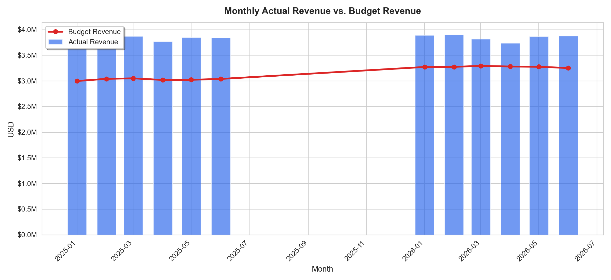
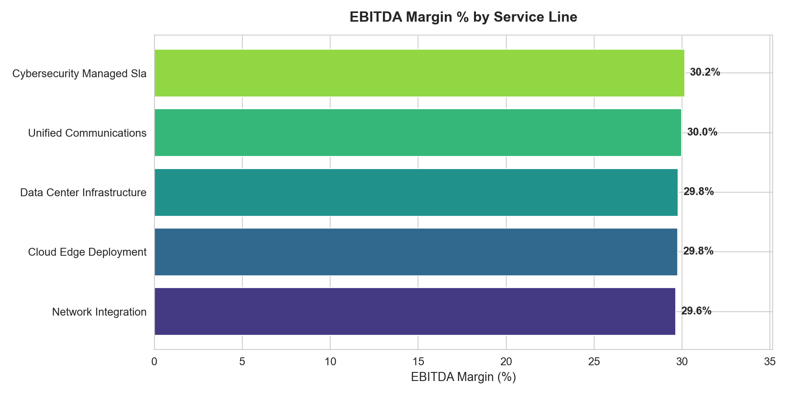
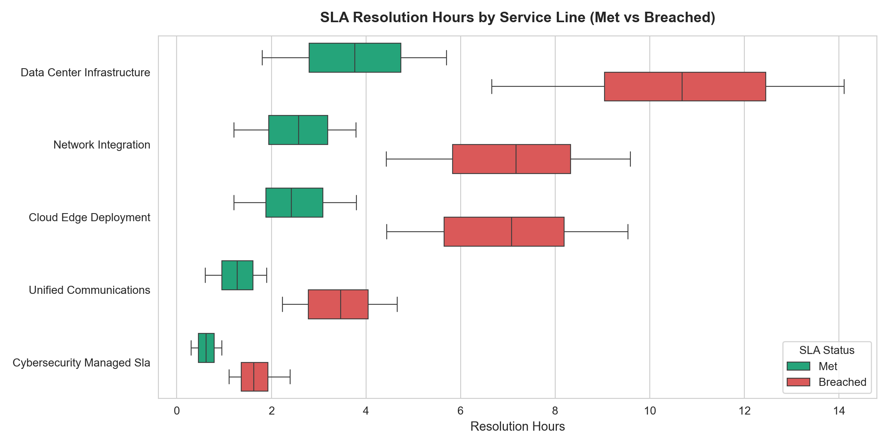
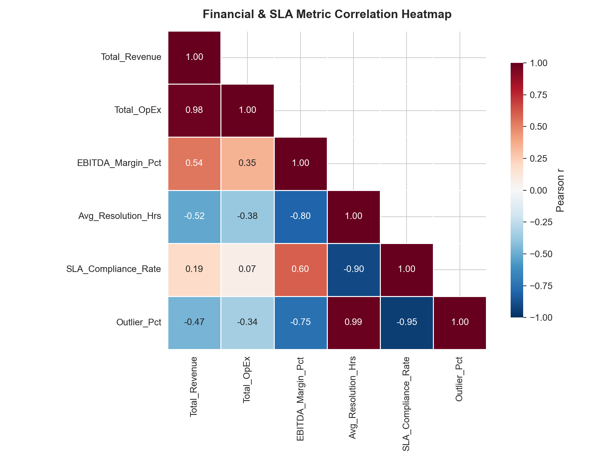

# 🏢 Enterprise IT FP&A & SLA Performance Suite

> A complete **Business Intelligence**, **Financial Planning & Analysis (FP&A)**, and **SLA Performance** suite — from raw data generation through ETL cleaning, EDA diagnostics, Power BI modeling, and Advanced Excel scenario analysis.


---

## 📑 Table of Contents

- [Project Overview](#-project-overview)
- [Architecture Overview](#-architecture-overview)
- [Folder Structure](#-folder-structure)
- [Quick Start](#-quick-start)
- [Data Generation](#-data-generation-generate_fpa_datapy)
- [Preprocessing & EDA](#-preprocessing--eda-preprocess_and_edapy)
- [EDA Charts](#-eda-diagnostic-charts)
- [Excel Financial Model](#-excel-financial-model)
- [Power Query ETL Guide](#-power-query-etl-cleaning-guide)
- [Star Schema & DAX Formulas](#-star-schema--dax-formulas)
- [Power BI Dashboard Layout](#-power-bi-dashboard-layout)
- [Data Dictionary & Governance](#-data-dictionary--governance)

---

## 🎯 Project Overview

Large technology service companies manage two critical tracks:

| Track | Key Question |
|-------|-------------|
| **Financial Performance** | Did each region hit its revenue budget? Are operating costs eating into profit margins? |
| **Operational Delivery** | Are engineers resolving client IT outages within the promised SLA contract hours? |

This suite **connects both worlds** into a unified BI & Financial Planning platform:

1. **Python** generates realistic raw corporate files with real-world data flaws
2. **Power Query** cleans & reshapes messy data using reproducible ETL steps
3. **Star Schema** connects dimension & fact tables in Power BI's Model View
4. **DAX formulas** calculate executive KPIs (EBITDA Margin, Budget Variance, SLA Compliance)
5. **Advanced Excel** provides What-If profit scenario testing & data governance documentation

---

## 🏗 Architecture Overview

```
┌─────────────────────────────────────────────────────────────────┐
│                    DATA GENERATION LAYER                        │
│              generate_fpa_data.py (Python + NumPy)              │
│   ┌──────────────┬──────────────┬──────────────┬──────────────┐ │
│   │ service_line │ regional_    │ actual_gl_   │ it_sla_      │ │
│   │ _master.csv  │ budgets_     │ financials   │ tickets_     │ │
│   │ (Dimension)  │ wide.csv     │ .csv (Fact)  │ log.csv      │ │
│   │ 5 rows       │ (Fact-Wide)  │ 2,880 rows   │ (Fact)       │ │
│   │ Whitespace & │ 20 rows ×    │ 15% dirty $  │ 3,045 rows   │ │
│   │ casing flaws │ 14 cols      │ & commas     │ 45 duplicates│ │
│   └──────────────┴──────────────┴──────────────┴──────────────┘ │
└──────────────────────────┬──────────────────────────────────────┘
                           ▼
┌─────────────────────────────────────────────────────────────────┐
│                    ETL / CLEANING LAYER                          │
│            preprocess_and_eda.py (Python + Pandas)              │
│   ┌────────────────────────────────────────────────────────┐    │
│   │ • Trim & Title-Case service names                      │    │
│   │ • Unpivot wide budgets → long (20 × 14 → 240 × 5)     │    │
│   │ • Strip $ and , from Revenue_USD → float64             │    │
│   │ • Deduplicate Ticket_ID (3,045 → 3,000)                │    │
│   │ • Flag IQR outliers on Resolution_Hours                │    │
│   │ • Derive SLA_Status (Met / Breached)                   │    │
│   └────────────────────────────────────────────────────────┘    │
└──────────────────────────┬──────────────────────────────────────┘
                           ▼
┌─────────────────────────────────────────────────────────────────┐
│                   ANALYSIS & REPORTING LAYER                    │
│  ┌─────────────────┐  ┌─────────────────┐  ┌────────────────┐  │
│  │   4 EDA Charts  │  │  Power BI PBIX  │  │  Excel Model   │  │
│  │   (PNG @ 200dpi)│  │  Star Schema +  │  │  SUMIFS/XLOOKUP│  │
│  │                 │  │  7 DAX Measures  │  │  + Sensitivity │  │
│  │                 │  │  2-Page Dashboard│  │  + Data Dict   │  │
│  └─────────────────┘  └─────────────────┘  └────────────────┘  │
└─────────────────────────────────────────────────────────────────┘
```

---

## 📂 Folder Structure

```
enterprise-it-fpa-sla-suite/
│
├── generate_fpa_data.py                # Step 1: Generate 4 raw CSVs
├── preprocess_and_eda.py               # Step 2: Clean + EDA charts
├── generate_excel_model.py             # Step 3: Build Excel workbook
│
├── raw_data/                           # Raw generated data (messy)
│   ├── service_line_master.csv         #   Dimension: 5 service lines
│   ├── regional_budgets_wide.csv       #   Fact: wide monthly budgets
│   ├── actual_gl_financials.csv        #   Fact: GL revenue & OpEx
│   └── it_sla_tickets_log.csv          #   Fact: SLA tickets + dupes
│
├── cleaned_data/                       # Cleaned data (analysis-ready)
│   ├── service_line_master.csv         #   Trimmed & title-cased
│   ├── regional_budgets_long.csv       #   Unpivoted to long format
│   ├── actual_gl_financials.csv        #   $ stripped, typed as float
│   └── it_sla_tickets_log.csv          #   Deduped + SLA_Status + IQR
│
├── eda_charts/                         # High-resolution diagnostic PNGs
│   ├── 01_monthly_revenue_vs_budget.png
│   ├── 02_ebitda_margin_by_service.png
│   ├── 03_sla_resolution_boxplots.png
│   └── 04_financial_correlation_heatmap.png
│
├── FPA_Scenario_Governance_Model.xlsx  # Excel: formulas + governance
└── README.md                           # This file
```

---

## 🚀 Quick Start

```bash
# 1. Install dependencies
pip install pandas numpy matplotlib seaborn openpyxl

# 2. Generate raw data (4 CSVs → raw_data/)
python generate_fpa_data.py

# 3. Clean data + generate EDA charts
python preprocess_and_eda.py

# 4. Build Excel financial model
python generate_excel_model.py
```

---

## 🔧 Data Generation (`generate_fpa_data.py`)

Uses `pathlib` for cross-platform path handling and `np.random.seed(101)` for reproducibility.

| Table | Rows | Intentional Flaw |
|-------|------|-----------------|
| `service_line_master.csv` | 5 | Leading/trailing spaces, inconsistent casing |
| `regional_budgets_wide.csv` | 20 × 14 cols | Wide format (12 month columns need unpivot) |
| `actual_gl_financials.csv` | 2,880 | `$` and `,` formatting in 15% of Revenue_USD |
| `it_sla_tickets_log.csv` | 3,045 | 45 duplicate Ticket_IDs appended |

**Key design decisions:**
- 2026 budgets auto-scaled +8% YoY (`growth = 1.08`)
- OpEx set between 58–82% of revenue for realistic EBITDA margins
- SLA split: ~86% Met, ~14% Breached (resolution 1.1×–2.4× target)

---

## 🧹 Preprocessing & EDA (`preprocess_and_eda.py`)

### Cleaning Pipeline

| Step | Transformation | Before → After |
|------|---------------|----------------|
| 1 | Trim + Title-Case | `"  Network Integration "` → `"Network Integration"` |
| 2 | Unpivot wide budgets | 20 rows × 14 cols → 240 rows × 5 cols |
| 3 | Strip `$` and `,` | `"$14,250.50"` → `14250.50` (float64) |
| 4a | Deduplicate tickets | 3,045 → 3,000 rows |
| 4b | IQR outlier flag | 206 Resolution_Hours outliers flagged |
| 4c | Derive SLA_Status | Met: 2,555 / Breached: 445 |

---

## 📊 EDA Diagnostic Charts

### Chart 1: Monthly Revenue vs. Budget


> Clustered column bars show actual monthly revenue; the red line overlays budget targets. Gaps reveal months with budget variance.

### Chart 2: EBITDA Margin % by Service Line


> Horizontal bar chart ranking each service line by operating profit margin. Cybersecurity typically shows highest margins due to lower OpEx ratios.

### Chart 3: SLA Resolution Hours (Box Plots)


> Split by Met vs. Breached status. Whiskers and outlier dots expose service lines with the widest resolution time variance.

### Chart 4: Financial & SLA Metric Correlation Heatmap


> Pearson correlations between Total Revenue, OpEx, EBITDA Margin %, Avg Resolution Hours, SLA Compliance Rate, and IQR Outlier %.

---

## 📗 Excel Financial Model

### `FPA_Scenario_Governance_Model.xlsx`

#### Tab 1: `Regional_Summary`

**Dynamic SUMIFS formulas** pull revenue and OpEx from the `Raw_GL` backing sheet:

```excel
// Column F — Actual Revenue per Service Line
=SUMIFS(Raw_GL!E:E, Raw_GL!D:D, A2)

// Column G — Actual OpEx per Service Line
=SUMIFS(Raw_GL!F:F, Raw_GL!D:D, A2)

// Column H — EBITDA Margin %
=IF(F2=0, 0, (F2-G2)/F2)
```

**XLOOKUP** for instant margin lookup by Service ID:

```excel
// Cell J10 — returns Target_Margin_Pct for the ID in J9
=XLOOKUP(J9, A2:A6, E2:E6, "Not Found")
```

#### 2-Variable Sensitivity Grid

A **What-If Data Table** crossing Revenue Growth (0% → +25%) against OpEx Reduction (-2% → -15%):

```excel
// Projected EBITDA Margin (corner formula)
=((SUM(F2:F6)*(1+B9)) - (SUM(G2:G6)*(1+B10))) / (SUM(F2:F6)*(1+B9))
```

| Rev Growth ↓ \ OpEx Δ → | -2% | -5% | -8% | -10% | -15% |
|--------------------------|-----|-----|-----|------|------|
| 0% | — | — | — | — | — |
| +5% | — | — | — | — | — |
| +10% | — | — | — | — | — |
| +15% | — | — | — | — | — |
| +20% | — | — | — | — | — |
| +25% | — | — | — | — | — |

> *Values auto-populate when you open the Excel file — all cells contain live formulas.*

#### Tab 2: `Data_Dictionary_Governance`

32 documented entries covering every table, field, data type, key status, and Power Query/DAX governance rule.

---

## 🔄 Power Query ETL Cleaning Guide

Exact click-by-click steps for cleaning in Power BI Desktop or Excel:

### Table: `service_line_master`

| Flaw | Fix |
|------|-----|
| Extra spaces & lowercase | Transform → Format → **Trim** → **Capitalize Each Word** |

### Table: `regional_budgets_wide`

| Flaw | Fix |
|------|-----|
| 12 month columns (wide) | Select `Region` + `Service_ID` → Right-click → **Unpivot Other Columns** |
| | Rename `Attribute` → `Month_Str`, `Value` → `Budget_Revenue_USD` |
| | Add Column → Custom Column: `Date.FromText([Month_Str] & "-01")` |

**Power Query M code (auto-generated):**
```powerquery-m
let
    Source = Csv.Document(File.Contents("raw_data/regional_budgets_wide.csv")),
    #"Promoted Headers" = Table.PromoteHeaders(Source),
    #"Unpivoted" = Table.UnpivotOtherColumns(
        #"Promoted Headers",
        {"Region", "Service_ID"},
        "Month_Str", "Budget_Revenue_USD"
    ),
    #"Added Budget_Date" = Table.AddColumn(
        #"Unpivoted", "Budget_Date",
        each Date.FromText([Month_Str] & "-01"), type date
    ),
    #"Changed Type" = Table.TransformColumnTypes(
        #"Added Budget_Date",
        {{"Budget_Revenue_USD", type number}}
    )
in
    #"Changed Type"
```

### Table: `actual_gl_financials`

| Flaw | Fix |
|------|-----|
| `$` and `,` in Revenue_USD | Replace Values: `$` → blank, `,` → blank → Change type to **Decimal** |

**Power Query M code:**
```powerquery-m
let
    Source = Csv.Document(File.Contents("raw_data/actual_gl_financials.csv")),
    #"Promoted Headers" = Table.PromoteHeaders(Source),
    #"Removed $" = Table.ReplaceValue(#"Promoted Headers", "$", "", Replacer.ReplaceText, {"Revenue_USD"}),
    #"Removed ," = Table.ReplaceValue(#"Removed $", ",", "", Replacer.ReplaceText, {"Revenue_USD"}),
    #"Changed Type" = Table.TransformColumnTypes(
        #"Removed ,",
        {{"Revenue_USD", type number}, {"OpEx_Cost_USD", type number}, {"Posting_Date", type date}}
    )
in
    #"Changed Type"
```

### Table: `it_sla_tickets_log`

| Flaw | Fix |
|------|-----|
| 45 duplicate tickets | Home → Remove Rows → **Remove Duplicates** on `Ticket_ID` |
| Missing SLA_Status | Add Column → **Conditional Column**: If `Resolution_Hours` ≤ `SLA_Target_Hours` → `"Met"`, Else `"Breached"` |

---

## ⭐ Star Schema & DAX Formulas

### Star Schema Relationships

```
                    ┌────────────────────────┐
                    │   Dim_Calendar         │
                    │   Date (PK)            │
                    └───┬────────┬───────┬───┘
                   1:*  │   1:*  │  1:*  │
          ┌─────────────┘        │       └──────────────┐
          ▼                      ▼                      ▼
┌──────────────────┐  ┌──────────────────┐  ┌──────────────────┐
│ regional_budgets │  │ actual_gl_       │  │ it_sla_tickets_  │
│ _wide            │  │ financials       │  │ log              │
│ Budget_Date (FK) │  │ Posting_Date(FK) │  │ Incident_Date(FK)│
│ Service_ID (FK)  │  │ Service_ID (FK)  │  │ Service_ID (FK)  │
└────────┬─────────┘  └────────┬─────────┘  └────────┬─────────┘
         │                     │                      │
         └─────────────────────┼──────────────────────┘
                          1:*  │
                    ┌──────────┴───────────┐
                    │ service_line_master   │
                    │ Service_ID (PK)      │
                    └──────────────────────┘
```

### Calendar Dimension (DAX)

```dax
Dim_Calendar = CALENDAR(DATE(2025, 1, 1), DATE(2026, 12, 31))
```

### 7 DAX Measures

```dax
// 1. Total Actual Revenue
Total Actual Revenue = SUM(actual_gl_financials[Revenue_USD])

// 2. Total Budget Revenue
Total Budget Revenue = SUM(regional_budgets_wide[Budget_Revenue_USD])

// 3. Budget Variance $
Budget Variance $ = [Total Actual Revenue] - [Total Budget Revenue]

// 4. Budget Variance %
Budget Variance % = DIVIDE([Budget Variance $], [Total Budget Revenue], 0)

// 5. EBITDA Margin %
EBITDA Margin % =
DIVIDE(
    [Total Actual Revenue] - SUM(actual_gl_financials[OpEx_Cost_USD]),
    [Total Actual Revenue],
    0
)

// 6. YoY Revenue Growth %
YoY Revenue Growth % =
VAR PrevYearRev = CALCULATE(
    [Total Actual Revenue],
    SAMEPERIODLASTYEAR(Dim_Calendar[Date])
)
RETURN DIVIDE([Total Actual Revenue] - PrevYearRev, PrevYearRev, 0)

// 7. SLA Compliance Rate %
SLA Compliance Rate % =
DIVIDE(
    CALCULATE(COUNTROWS(it_sla_tickets_log), it_sla_tickets_log[SLA_Status] = "Met"),
    COUNTROWS(it_sla_tickets_log),
    0
)
```

> **Why `DIVIDE(..., 0)` instead of `/`?** — If a dashboard filter yields zero in the denominator, `DIVIDE` returns 0 instead of an `Infinity` / `NaN` error.

---

## 📊 Power BI Dashboard Layout

### Page 1 — Executive FP&A & Budget Variance

| Visual | Configuration |
|--------|--------------|
| 4 × Card KPIs | Total Actual Revenue, Budget Variance %, EBITDA Margin %, YoY Revenue Growth % |
| Line + Clustered Column | X: `Dim_Calendar[Date]` (Year/Month) · Columns: Actual Revenue · Line: Budget Revenue |
| Matrix | Rows: Region → Service_Line_Name · Values: Actual Rev, Budget Rev, Variance % (conditional red/green) |

### Page 2 — IT Service Operations & SLA

| Visual | Configuration |
|--------|--------------|
| 3 × Card KPIs | Total Tickets, SLA Compliance Rate %, Avg Resolution Hours |
| 100% Stacked Bar | Y: Service_Line_Name · X: Count of Ticket_ID · Legend: SLA_Status |
| Scatter Plot | X: SLA Compliance Rate % · Y: EBITDA Margin % · Values: Service_Line_Name |

---

## 📋 Data Dictionary & Governance

Full documentation lives in `FPA_Scenario_Governance_Model.xlsx` → Tab `Data_Dictionary_Governance`, covering:

| Column | Description |
|--------|-------------|
| `Table_Name` | Source table name |
| `Field_Name` | Column / measure name |
| `Data_Type` | Text, Decimal, Date, DAX Measure |
| `Primary_or_Foreign_Key` | PK / FK relationship mapping |
| `Power_Query_Governance_Rule` | Exact cleaning step, M formula, or DAX definition |

---

## 🛠 Tech Stack

| Layer | Technology |
|-------|-----------|
| Data Generation | Python 3.12, pandas, NumPy |
| Data Cleaning | Python (pandas) / Power Query (M) |
| EDA Visualization | matplotlib, seaborn |
| Financial Modeling | Excel (openpyxl) — SUMIFS, XLOOKUP, What-If |
| BI Dashboard | Power BI Desktop — Star Schema, DAX |
| Version Control | Git |

---

## 📜 License

This project is provided under the **MIT License** for educational and portfolio purposes.

---

<p align="center">
  <b>Built with ❤️ by Shubhradeep Dhali for Enterprise Financial Analytics & SLA Performance Monitoring</b>
</p>
